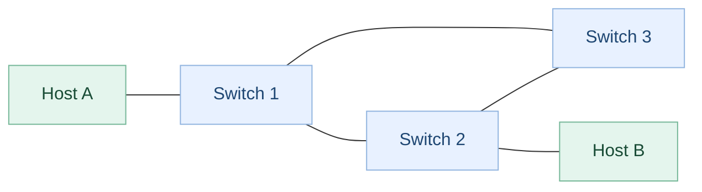
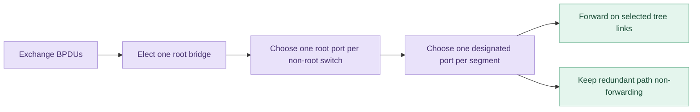
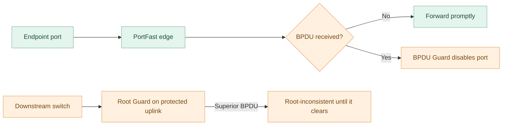
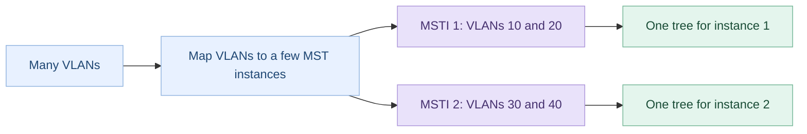

# Spanning Tree Protocols: STP, PVST+, RSTP and MST

**Study goal:** Understand how Ethernet switches keep redundant Layer 2 links available without allowing frames to circulate forever. Learn to predict the active topology, verify it on Cisco switches, and choose the right protection and scaling model.

**In scope:** Classic IEEE 802.1D STP, Cisco PVST+, Rapid STP (802.1w / Cisco Rapid PVST+), and Multiple STP (802.1s / MSTP). Command examples use common Cisco IOS/IOS XE syntax; check the target image because syntax and supported limits vary.

## The problem STP solves

Ethernet switches learn source MAC addresses and flood broadcasts, unknown unicasts, and some multicasts out eligible ports. A loop gives those frames a circular path. Unlike an IP packet, an ordinary Ethernet frame has no hop limit, so the same frame can keep circulating. Each switch can relearn a source MAC on a different port, creating MAC flapping; broadcasts multiply, links saturate, and switch control planes can be overwhelmed.

Redundant links are still useful: they give traffic another route after a failure. STP lets switches keep the physical redundancy but block selected forwarding paths so the active forwarding topology is loop-free. A blocked path can become active after the topology changes.



The triangle illustrates a Layer 2 loop when all three inter-switch links forward. STP breaks the cycle by placing one port in a non-forwarding role/state. It does not remove the cable, and it does not block every redundant link in every VLAN or instance.

## The mental model: elect, calculate, block

STP builds a tree per spanning-tree instance. Switches exchange **Bridge Protocol Data Units (BPDUs)**. A BPDU carries the sender's view of the root bridge, its path cost to that root, its own bridge ID and port ID, and timer/flag information. Each switch starts by advertising itself as root. Better information replaces that view and is propagated through the topology.



The **root bridge** is the logical reference point, not necessarily the physical center of the network. Every other switch chooses one **root port**: its best path toward the root. On each shared Layer 2 segment, switches compare their path information and one **designated port** forwards toward the root for that segment. Remaining redundant paths are held from forwarding. The root bridge has designated ports and no root port.

## Root election and port selection

### Bridge ID and root bridge

A Bridge ID combines a configurable priority, an extended system ID (commonly the VLAN ID in per-VLAN Cisco modes), and a MAC address. The lowest numerical Bridge ID wins. Priority is compared before MAC address, so a deliberately lower priority is the normal way to control root placement. If priorities tie, the lower MAC address wins. With the common default priority of 32768 on all switches, the MAC address often decides the winner; this may be a poor design if the resulting root is an access switch or an inconvenient path location.

### Root port decision

For each non-root switch, STP first prefers the best BPDU advertising the lowest root Bridge ID, then the lowest total path cost to that root. If cost ties, the protocol uses deterministic BPDU/port-ID tie-breakers. A useful Cisco IOS/IOS XE study sequence is:

| Order | Comparison | Preferred value |
|---:|---|---|
| 1 | Advertised root Bridge ID | Lowest |
| 2 | Total root path cost through the neighbor | Lowest |
| 3 | Neighbor / designated Bridge ID | Lowest |
| 4 | Neighbor / designated Port ID | Lowest |
| 5 | Local Port ID, if still tied | Lowest |

Exact displayed and implemented tie-break details can vary by protocol mode and platform. For exam questions, read the supplied BPDUs and apply the stated comparison order; on a real switch, verify the selected root port with `show spanning-tree`.

### Designated port and blocked alternative

On a segment, the switch advertising the better path to the root wins designated-bridge status; its port toward that segment is designated and forwards. If the path costs tie, Bridge ID and then port ID resolve the result. On point-to-point switch links, the far end of the selected root port is normally designated. The other side may be an alternate path and does not forward user traffic until it is selected after a change.

Port **cost** is an administrative metric, not a direct measurement of current congestion or packet latency. Default cost depends on link speed and the configured short/long cost method. For deterministic study problems, use the costs stated in the problem. In production, verify with `show spanning-tree` rather than assuming every platform uses the same cost table.

### Small worked example

Assume SW1 is the root. SW2 and SW3 each reach SW1 directly over links with cost 4. There is also a redundant SW2–SW3 link. SW2 and SW3 each have a root path cost of 4; on their shared segment, the lower Bridge ID wins designated status. The other side does not forward in that instance. If SW2's direct link to SW1 fails, its alternate path through SW3 can become active, subject to the convergence behavior of the protocol in use.

This is why a diagram alone is not enough: annotate root IDs, path costs, port IDs, and the spanning-tree instance before deciding which port blocks.

## Port roles, states and convergence

Roles answer **what a port does in the topology**. States answer **whether it forwards frames**. Do not use role and state as synonyms.

| Role | Purpose | Typical state |
|---|---|---|
| Root | Best path from this switch toward the root bridge; one per non-root switch | Forwarding |
| Designated | Best path from this segment toward the root; one per segment/instance | Forwarding |
| Alternate | A different path toward the root, learned from another switch | Discarding / blocking |
| Backup | Redundant path to the same shared segment on the same switch; uncommon in switched Ethernet | Discarding / blocking |
| Disabled | Not participating in the active topology | Discarding / disabled |

Classic 802.1D has **blocking, listening, learning, forwarding** (and disabled) states. A topology change can make ports wait through listening and learning before forwarding. The familiar default timers are hello 2 seconds, max age 20 seconds, and forward delay 15 seconds, but timer behavior depends on the active protocol and topology. Classic STP convergence can take tens of seconds; do not treat a timer sum as a universal outage prediction.

RSTP uses **discarding, learning, forwarding** states and adds the alternate/backup roles. On suitable point-to-point links, it can converge faster by using explicit proposal/agreement synchronization rather than waiting only for legacy timer progression. A legacy neighbor or a topology that cannot use rapid transitions can reduce that advantage. Measure actual interruption and verify the negotiated mode on the target platform.

## Cisco edge safeguards: PortFast, BPDU Guard and Root Guard

### PortFast means edge behavior, not “turn STP off”

PortFast lets an access edge port enter forwarding promptly instead of waiting for the classic listening/learning delay. STP remains enabled. Use it for a host-facing edge port that is not intended to connect to another switch. Enabling it on a switch-to-switch link can allow a loop before the topology is protected.

### BPDU Guard protects an edge assumption

BPDU Guard shuts down (typically places into err-disabled state) a PortFast-protected port if it receives a BPDU. That catches a switch or bridge accidentally connected where an endpoint was expected. Global BPDU Guard defaults apply to PortFast ports; per-interface commands can be configured directly. Recovery and alerting policy should be deliberate.

```ios
interface GigabitEthernet1/0/10
 description Endpoint access port
 switchport mode access
 spanning-tree portfast
 spanning-tree bpduguard enable
```

Some Cisco images support global defaults such as `spanning-tree portfast default` and `spanning-tree portfast bpduguard default`. Confirm platform behavior and scope before applying them. BPDU Guard is a protection response, not a substitute for correct edge-port design.

### Root Guard protects where a superior root must not appear

Root Guard belongs on designated-facing ports where the design says that downstream devices must never become the root path. If a superior BPDU arrives, the port becomes **root-inconsistent** and stops forwarding until the superior information disappears. It protects root placement; it does not generally block all attacks or every kind of Layer 2 loop.



For a host access port, the common pairing is PortFast plus BPDU Guard. Root Guard is for a different boundary: a port that should remain designated and must reject a superior root claim. Avoid applying both by rote; select a guard based on what that port is allowed to connect to.

## Cisco spanning-tree modes

| Mode | Tree scope | Main trade-off |
|---|---|---|
| STP / 802.1D | One tree for the bridged domain | Broad compatibility; classic convergence behavior |
| PVST+ | One Cisco spanning-tree instance per VLAN | Per-VLAN path choice enables load sharing, at the cost of more control-plane instances and BPDU/state work |
| Rapid PVST+ | Rapid spanning tree per VLAN | Per-VLAN control with RSTP rapid transition behavior; still has per-VLAN scaling cost |
| MSTP | A small number of trees, with VLANs mapped to instances | Reduces instance count at scale; requires consistent region configuration and deliberate VLAN mapping |

PVST+ allows different VLANs to choose different roots and forwarding paths. This can use redundant trunks more effectively, but it increases instance work as VLAN count grows. A switch that is root for VLAN 10 need not be root for VLAN 20. The topology is therefore **per instance**, not a single universal blocked-link diagram.

MST groups VLANs into Multiple Spanning Tree Instances (MSTIs). VLANs mapped to the same instance share that instance's spanning-tree topology. Instance 0 is the Internal Spanning Tree (IST); the Common and Internal Spanning Tree (CIST) provides the common view across regions. An MST region boundary is determined by the region configuration, including **name, revision number, and VLAN-to-instance mapping**. Those values must match exactly for switches to be in the same region. A mismatch creates a boundary; it is a common cause of surprising topology behavior.



### Choosing a mode

For a small or legacy environment, compatibility and the current design may outweigh the benefits of changing modes. Rapid PVST+ is common in Cisco campus networks where per-VLAN path control is useful. MST is useful when many VLANs share a smaller number of intended topologies and operators can keep the region mapping consistent. A mode migration can change the forwarding topology and cause an outage; plan it as a network change, not a cosmetic setting.

## Configuration and verification workflow

### Set intentional roots in PVST+ / Rapid PVST+

```ios
! Example: make SW1 preferred root for VLANs 10 and 20
spanning-tree vlan 10,20 root primary

! Place a second switch as the planned secondary
spanning-tree vlan 10,20 root secondary

! Or set explicit priority; allowed values are multiples of 4096
spanning-tree vlan 10 priority 4096
```

The `root primary` and `root secondary` macros choose priorities relative to what the switch currently sees; inspect the resulting configuration and state. Explicit priorities are easier to audit in a tightly controlled design. The default base priority is 32768 and configured values are in 4096 increments (0 through 61440); the extended system ID is represented in the Bridge ID as well.

### Create an MST region (example only)

```ios
spanning-tree mode mst
spanning-tree mst configuration
 name CAMPUS-A
 revision 7
 instance 1 vlan 10,20
 instance 2 vlan 30,40
 exit
spanning-tree mst 1 root primary
spanning-tree mst 2 root secondary
```

Apply the identical name, revision, and VLAN mapping to every switch intended to be inside this region. Keep a version-controlled source of truth for that mapping. The example's instance numbers and VLAN ranges are illustrative; agree them with the actual topology and platform limits.

### Prove what the network is doing

```ios
show spanning-tree summary
show spanning-tree vlan 10
show spanning-tree root
show spanning-tree interface GigabitEthernet1/0/10 detail
show spanning-tree inconsistentports
show spanning-tree mst configuration
show spanning-tree mst
show spanning-tree blockedports
```

Start with the mode and instance, then check the root Bridge ID, local Bridge ID, root path cost, root port, port roles/states, timers, and any inconsistent/blocked ports. Compare both ends of each link. A “blocked” port is not automatically a fault: it may be the intended loop-prevention path. `show spanning-tree` command variants differ across IOS/IOS XE and NX-OS; use context help on the lab image.

## Practical lab: predict, prove, fail, recover

Build three switches in a triangle. Connect one endpoint to each access switch. Use one VLAN first, then add a second VLAN. Record the expected root, root port on each non-root switch, designated port on each segment, and non-forwarding redundant port before enabling STP.

1. Inspect the default root election and port costs.
2. Set SW1 as root for VLAN 10 and SW2 as root for VLAN 20. Verify that the VLANs can select different trees where the topology and link costs permit it.
3. Configure PortFast and BPDU Guard on an endpoint port. In an isolated lab, connect a switch to that port and observe the protection response; restore the endpoint topology afterward.
4. Apply Root Guard to a designated-facing boundary port. Inject a superior BPDU only in the isolated lab and observe the root-inconsistent state.
5. Convert the lab to MST. Map VLANs 10 and 20 to one instance, and VLAN 30 to another. Verify region membership and each instance's tree.
6. Shut one active link, observe reconvergence, restore it, and compare lost pings, topology events, and convergence time between classic STP and rapid mode where supported.

```ios
show spanning-tree vlan 10
show spanning-tree vlan 20
show spanning-tree detail
show interfaces status
show logging | include SPANTREE|SPANNING|ERR_DISABLE
```

Do not test loop formation or guard behavior on a production network. In the lab, capture the before/after role and state, the event log, and packet loss. This turns “STP is working” into evidence that the intended path is active and a failure path can take over.

## Troubleshooting from symptoms

| Symptom | Check first | What it may mean |
|---|---|---|
| Unexpected root bridge | Root ID, VLAN/instance, priority, mode | Default election selected an unintended switch, or configuration/mode differs |
| Wrong trunk is blocked | Per-instance root, path cost, Bridge ID and Port ID tie-breaks | STP may be behaving correctly for a different root or cost than assumed |
| PortFast port does not come up normally | BPDU Guard state, received BPDUs, interface err-disable reason | A bridge may be connected to an endpoint-only port, or the edge assumption is wrong |
| Root-inconsistent port | Root Guard location and superior BPDU source | A downstream switch is advertising a better root than permitted |
| MST switches appear in different regions | Region name, revision, VLAN map, active mode | Any mismatch separates the region configuration |
| Intermittent MAC moves or broadcast spike | Loop, mispatch, channel/dual link, STP state changes | A Layer 2 cycle or unexpected forwarding path may exist |

Before changing a priority or cost, save the current state and write down the intended root and forwarding tree. Changing the tree can move traffic, briefly interrupt forwarding, and expose a hidden redundant-link problem.

## What to remember

- STP preserves redundant physical paths while forming a loop-free forwarding tree **per instance**.
- Lowest Bridge ID wins root; root path cost and deterministic Bridge ID/Port ID comparisons choose ports.
- A root port is the best route toward the root on a non-root switch. A designated port is the forwarding representative for its segment.
- Classic STP and RSTP use different convergence/state mechanics. Port role and port state describe different things.
- PortFast is for edge ports. BPDU Guard detects an unexpected BPDU there. Root Guard protects a designated boundary from an unauthorized superior root.
- PVST+ gives each VLAN a tree; MST maps many VLANs onto fewer trees. Each improves some trade-offs and adds its own operational requirements.
- Verify the actual root, cost, role, state, mode, and instance with show commands before diagnosing a blocked link as broken.

## References

- Cisco, [Spanning Tree Protocol configuration guide (Catalyst 9000)](https://www.cisco.com/c/en/us/td/docs/switches/lan/c9000/lyr2-fwd/stp/stp-configuration-guide/m-stp.html).
- Cisco, [Configuring Spanning Tree Protocol (Catalyst 9200)](https://www.cisco.com/c/dam/en/us/td/docs/switches/lan/catalyst9200/software/release/16-12/configuration_guide/lyr2/configuring_spanning_tree_protocol.html).
- Cisco, [Optional spanning-tree features: PortFast, BPDU Guard and Root Guard](https://www.cisco.com/en/US/docs/switches/metro/me3600x_3800x/trash/swstpopt.html).
- Cisco, [Configuring MST using Cisco NX-OS (Nexus 9000)](https://www.cisco.com/c/en/us/td/docs/dcn/nx-os/nexus9000/105x/configuration/layer-2-switching/cisco-nexus-9000-series-nx-os-layer-2-switching-configuration-guide-105x/m-configuring-mst.html).

## Source lesson

This article extracts and reorganizes the STP/PVST+/RSTP/MST material in the provided CCNP lesson PDF. It replaces slide screenshots with original diagrams and explanations, and checks Cisco-specific behavior against the official configuration references above.
