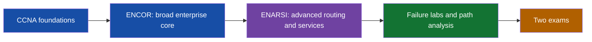

# CCNP Enterprise — ENCOR + ENARSI, with low latency applications

**Track:** 350-401 ENCOR v1.1 (core) + 300-410 ENARSI v1.1 (concentration). Passing both earns CCNP Enterprise. Cisco lists no formal prerequisite for either exam; the CCNA knowledge in your existing course is the assumed starting point.

## Course index

| Order | Document | Outcome |
|---:|---|---|
| 0 | [Syllabus and schedule](00_syllabus.md) | Scope, blueprint map, milestones |
| 1 | [Architecture and virtualization](01_encor_architecture_virtualization.md) | Enterprise design, QoS, SD-WAN/Access, VRF, overlays |
| 2 | [Infrastructure](02_encor_infrastructure.md) | Campus switching, OSPF, eBGP, wireless, services |
| 3 | [Assurance, security and automation](03_encor_assurance_security_automation.md) | Telemetry, capture, APIs, AAA, CoPP, Python/JSON |
| 4 | [Advanced routing](04_enarsi_advanced_routing.md) | EIGRP, OSPF, BGP, redistribution, policy |
| 5 | [VPN technologies](05_enarsi_vpn.md) | MPLS L3VPN, DMVPN, VRF-Lite |
| 6 | [Security and services](06_enarsi_security_services.md) | uRPF, IPv6 first hop, management, DHCP, IP SLA, NetFlow |
| 7 | [Workflows and diagrams](07_packet_flows_and_workflows.md) | Packet paths and fault isolation in plain text/Mermaid |
| 8 | [Hands-on labs](08_labs.md) | Build, break, diagnose, restore |
| 9 | [Commands](09_command_reference.md) | IOS/IOS XE checks and safe examples |
| 10 | [Knowledge Q&A](10_qa.md) | Retrieval practice with reasoned answers |
| 11 | [Scenario Q&A](11_scenario_qa.md) | Multi-symptom cases and root cause |
| 12 | [Practice assessments](12_practice_assessments.md) | Original ENCOR/ENARSI questions and rubric |
| 13 | [Worked examples](13_worked_examples.md) | Route calculations, policy decisions and packet diagnosis |
| 14 | [Blueprint checklist](14_blueprint_checklist.md) | Track each published topic to its lesson and lab |
| 15 | [Spanning Tree Protocols](15_spanning_tree_protocols.md) | STP, PVST+, RSTP, MST, root/port selection, safeguards and labs |

**Tutor method:** For each topic, explain the packet path, configure a small topology, prove the resulting state, inject one fault, and explain the repair from evidence. Purple **ULL notes** connect a topic to trading networks. They add job depth and should not displace exam coverage.

**Lab notation:** Command examples are illustrative IOS/IOS XE syntax. Features differ by image and release; confirm with `?` and Cisco platform documentation. CML, EVE-NG, or suitable virtual IOS images cover more of this track than Packet Tracer. Lab examples use documentation prefixes (`192.0.2.0/24`, `198.51.100.0/24`, `203.0.113.0/24`, `2001:db8::/32`).

**Blueprint sources:** [Cisco CCNP Enterprise certification](https://www.cisco.com/site/us/en/learn/training-certifications/certifications/enterprise/ccnp-enterprise/index.html), [ENCOR exam](https://www.cisco.com/site/us/en/learn/training-certifications/exams/encor.html), [ENARSI exam](https://www.cisco.com/site/us/en/learn/training-certifications/exams/enarsi.html). Confirm exam topics before booking; Cisco may revise them.
