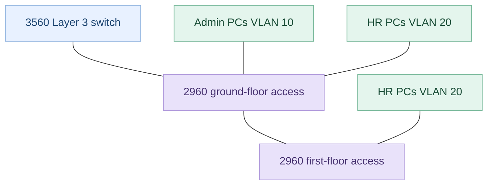

# Networking and Systems — Quick Notes

Short refresher notes from the class and personal study material. Command syntax and feature limits vary by device; confirm with the target platform.

## 1. Ethernet and switching

- A MAC address is 48 bits, shown as six hexadecimal bytes, e.g. `34:AB:CD:12:34:56`.
- **Unicast** targets one host; **broadcast** targets `FF:FF:FF:FF:FF:FF`; **multicast** targets a group.
- Ethernet frame: destination MAC → source MAC → EtherType/length → payload/padding → FCS. Preamble/SFD precede it. Untagged frames are typically 64–1518 bytes, excluding preamble/SFD; an 802.1Q tag adds four bytes. FCS detects corruption; it does not correct it.
- A switch learns source MACs per VLAN, then forwards known unicast to the learned port. Unknown unicast and broadcasts flood eligible ports in that VLAN, excluding the ingress port.
- ARP resolves a local IPv4 next-hop address to a MAC address. Hostname, MAC and IP identify different things.
- Check VLAN membership, port state and MAC moves before diagnosing an IP problem.
- A router forwards between IP networks. A Layer 2 switch forwards frames within a VLAN. A firewall applies traffic policy.
- Simplex is one-way; half duplex takes turns; full duplex sends and receives at the same time.

```text
show mac address-table
show interfaces
show interfaces status
show vlan brief
```

## 2. VLANs and inter-VLAN routing

- A VLAN is a logical Layer 2 broadcast domain. Different VLANs are separate Layer 2 networks; traffic between them needs Layer 3 routing.
- **Access port:** carries one data VLAN to an endpoint. A voice VLAN may also be configured for an IP phone.
- **Trunk port:** carries multiple VLANs between switches or to a router/L3 switch, using 802.1Q tags (native VLAN frames are untagged on typical Cisco trunks).
- Each IP subnet should normally map to its own VLAN/subnet plan. Do not reuse one IPv4 subnet across separate VLANs in a routed design.
- Inter-VLAN routing uses an L3-switch SVI (one gateway interface per VLAN) or router-on-a-stick (802.1Q subinterfaces over a trunk).

```ios
vlan 10
 name ADMIN
interface FastEthernet0/1
 switchport mode access
 switchport access vlan 10
interface GigabitEthernet0/1
 switchport mode trunk
 switchport trunk allowed vlan 10,20
```

For an L3 switch, enable routing and create an SVI for each VLAN, for example `interface vlan 10` with the gateway IP. For router-on-a-stick, configure matching subinterfaces, `encapsulation dot1q <vlan-id>`, and gateway IPs. Configure the hosts with the correct subnet mask and default gateway.

**Class topology:** two 2960 access switches (ground and first floor) connect by a trunk; a 3560 multilayer switch provides the routed gateways. Admin (VLAN 10) and HR (VLAN 20) clients can appear on either floor. The class image showed the same `192.168.1.x` network on multiple VLANs; use distinct subnets for a routed lab.



VLAN 1 is commonly the default VLAN; follow the network design for management and user traffic instead of assuming it should carry ordinary endpoints. If a VLAN is deleted, ports assigned to it can become inactive; create the replacement VLAN and reassign those ports explicitly.

## 3. IPv4, OSI and network basics

- IPv4 has 32 bits in four 8-bit octets (0–255). Prefix length defines the network boundary. Modern routing uses CIDR, not historical address classes.
- `/16` has 65,536 addresses; a conventional subnet has 65,534 usable host addresses. `/31` and `/32` have special uses.
- Private ranges: `10.0.0.0/8`, `172.16.0.0/12`, `192.168.0.0/16`.
- `127.0.0.0/8` is loopback; pinging it tests the local IP stack, not the NIC or cable. `169.254.0.0/16` is IPv4 link-local/APIPA and can indicate DHCP did not succeed.
- In a `/24`, `.0` is the network address and `.255` is the broadcast address; host rules depend on the prefix.
- Ping output `56(84) bytes` describes packet sizes. `ttl=64` is the received TTL, not the number of hops. Routers decrement TTL to prevent indefinite forwarding loops.
- OSI: Application → Presentation → Session → Transport → Network → Data Link → Physical.
- Campus roles: access connects endpoints; distribution aggregates access and often applies routing/policy; core provides resilient transport. These are design roles, not strict OSI boundaries.
- LAN is local; MAN is metropolitan; WAN spans larger geographic areas. Twisted pair, coax and fibre are guided media; Wi-Fi uses radio.
- Common topologies: star connects endpoints to a central device; full mesh connects every pair; ring connects neighbours in a loop; bus shares a medium.
- Copper reach is commonly up to 100 m for many Ethernet standards; verify the specific standard, cable, optic and distance.
- A circuit reserves a path/resources; packet switching forwards packets; message switching stores and forwards messages.

## 4. Spanning Tree Protocol (STP)

- STP prevents Layer 2 loops while preserving redundant links. A loop can multiply broadcasts, flap MAC-table entries and saturate links.
- Lowest Bridge ID becomes root: priority/extended system ID first, then MAC address. Non-root switches choose a root port toward the root; each segment elects a designated port. Redundant ports do not forward in that instance.
- Lower root path cost wins; deterministic Bridge ID/Port ID tie-breakers resolve ties. Cost is a metric, not a latency measurement.
- Root ports exist on non-root switches. Root-bridge ports on active segments are designated.
- Classic STP states include blocking, listening, learning and forwarding. RSTP uses discarding, learning and forwarding, with alternate/backup roles for redundant paths and faster transitions on suitable links.
- PortFast is for endpoint edge ports; it does not disable STP. Pair with BPDU Guard to shut an edge port that unexpectedly receives a BPDU. Root Guard protects a designated boundary from a superior root claim.
- PVST+ provides a tree per VLAN; Rapid PVST+ adds rapid transitions per VLAN. MST maps many VLANs to fewer trees. MST region name, revision and VLAN mapping must match.
- Verify the actual root, cost, role, state and instance:

```ios
show spanning-tree
show spanning-tree vlan 10
show spanning-tree root
show spanning-tree inconsistentports
```

For the full worked explanation, guard configuration and lab, see [Spanning Tree Protocols](../02_ccnp/15_spanning_tree_protocols.md).

## 5. EtherChannel

- EtherChannel combines compatible links into one logical port-channel for capacity and resilience. One flow usually hashes onto one member; it does not stripe every packet across all links.
- **LACP:** `active` initiates; `passive` responds. At least one end must be active. **PAgP:** `desirable` initiates; `auto` responds. **Static `on`:** no negotiation; configure consistently on both ends.
- Member links must agree on key settings such as speed/duplex, Layer 2/3 mode, access/trunk mode, VLAN/native VLAN and allowed VLANs. Limits depend on platform.
- `P` means bundled, `I` individual, `s` suspended; `S` Layer 2, `R` Layer 3, `U` in use in common Cisco summary output.
- STP sees the port-channel as one logical port. Its cost depends on platform and configured cost method; do not assume it is a fixed sum of member costs.

```ios
interface range FastEthernet0/1-4
 channel-group 2 mode active
show etherchannel summary
show etherchannel port-channel
show spanning-tree
```

If members are suspended, check protocol and configuration at both ends. A log such as “LACP not enabled on remote port” means the peer is not negotiating that channel as LACP.

## 6. Precision Time Protocol (PTP)

- PTP (IEEE 1588) synchronizes clocks; it is different from a point-to-point network link.
- The grandmaster is the reference. Ordinary clocks synchronize at endpoints; boundary clocks relay timing between ports; transparent clocks account for residence time.
- Hardware timestamps near the NIC reduce software scheduling noise. Clock quality and path asymmetry still limit accuracy.
- `ptp4l` runs PTP and can synchronize the NIC's PTP hardware clock (PHC). `phc2sys` synchronizes clocks, commonly system clock to PHC.
- Check interface timestamp support with `ethtool -T <interface>`. Check service logs with `journalctl -u ptp4l` when managed under that unit name.
- Troubleshoot domain/profile, timestamp mode, grandmaster selection, offset stability, path asymmetry and competing clock daemons. Whole-second offsets can indicate UTC/PTP timescale mismatch.

## 7. Linux networking and low-latency notes

- Standard sockets use the kernel network stack. Kernel-bypass approaches reduce work on the packet path but need careful NIC, driver, CPU/queue and application configuration.
- DPDK poll-mode drivers access NIC RX/TX descriptor rings from user space and poll rather than relying on per-packet interrupts. Polling can reduce latency variability but consumes dedicated CPU while active.
- OpenOnload is a user-space networking acceleration option for supported NICs/applications; behavior depends on platform and configuration.
- RDMA allows an application to access remote memory with reduced CPU involvement compared with conventional messaging; both endpoints, NIC/fabric and application must support the chosen mode.
- Linux kernel responsibilities include scheduling, virtual filesystems, memory management and device drivers. System calls cross the user/kernel boundary; reducing work or transitions can help, but gains are workload-dependent.
- A ring buffer is a bounded circular producer/consumer queue. It avoids moving elements on each dequeue; synchronization and ownership still matter. DPDK commonly uses descriptor rings.
- A socket buffer is kernel networking memory; do not treat it as synonymous with an application's ring buffer.

## 8. C/system-call reminders

| Item | Quick meaning |
|---|---|
| `open`, `read`, `write`, `close` | Basic file-descriptor lifecycle |
| `lseek` | Change a file offset |
| `fsync` | Request persistence of file data/metadata to storage |
| `fcntl` | Get/set file-descriptor flags and related controls |
| `ioctl` | Device- or subsystem-specific control operation |
| `pipe2` | Create a pipe, optionally with flags |
| `shmget` | Obtain/create a System V shared-memory segment |
| Semaphore | Counter-based coordination; a mutex is a lock for exclusive ownership |
| `perror` | Print a message based on the current `errno` |
| `malloc` | Allocates heap memory; returns `NULL` on failure, not `-1` |
| `for (;;)` / `while (1)` | Infinite loop unless exited/broken |

A file descriptor is an integer handle. File operations advance the current offset; `lseek` changes it. Linked-list nodes need not be contiguous in memory, unlike array elements.

## 9. Quick fault checks

| Symptom | First checks |
|---|---|
| Link down | Cable/optic, peer port, admin state, speed/duplex |
| CRC/input errors | Physical quality, optic, cable and interface counters |
| Collisions | Half-duplex/shared media or duplex mismatch |
| Runts/giants | Frame size, physical faults, MTU and platform counters |
| Output drops | Egress congestion, queue pressure, shaping |
| Wrong VLAN reachability | Access VLAN, trunk allowed/native VLAN, SVI/gateway, subnet and host gateway |
| EtherChannel not forming | LACP/PAgP mode and matching member configuration on both ends |
| DHCP gives `169.254.x.x` | DHCP service, VLAN, trunk, relay and address pool |

Read counter changes over time, not only lifetime totals. A redundant link without loop prevention can create a broadcast storm. A **SPOF** is a single point of failure.

## 10. Routing protocol reminders

- **BGP** exchanges routes between autonomous systems and within an AS (iBGP).
- **OSPF** is a link-state interior gateway protocol.
- **PIM** builds multicast forwarding trees.
- **BFD** detects path failures quickly; it does not calculate routes.
- **Tunnel**: a logical point-to-point path carried over another network. GRE, IPsec and MPLS are different technologies with different encapsulation and security properties.

## References

- Cisco, [Spanning Tree Protocol configuration](https://www.cisco.com/c/en/us/td/docs/switches/lan/c9000/lyr2-fwd/stp/stp-configuration-guide/m-stp.html).
- DPDK, [Poll Mode Drivers](https://doc.dpdk.org/guides/prog_guide/ethdev/ethdev.html).
- Linux PTP, [`ptp4l`](https://www.linuxptp.org/documentation/ptp4l/) and [`phc2sys`](https://www.linuxptp.org/documentation/phc2sys/).
- IANA, [Special-purpose IPv4 address registry](https://www.iana.org/assignments/iana-ipv4-special-registry).

**Study reminder:** Work consistently; let finished work show progress.
