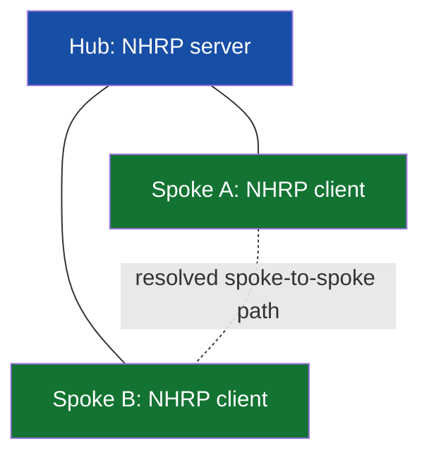

# ENARSI 2 — VPN technologies

## Contents

- [MPLS forwarding](#mpls-forwarding)
- [MPLS Layer 3 VPN](#mpls-layer-3-vpn)
- [DMVPN](#dmvpn)
- [Tunnel troubleshooting](#tunnel-troubleshooting)

## MPLS forwarding

MPLS forwards using labels. A **label switch router (LSR)** swaps or removes labels along a **label switched path (LSP)**. LDP can distribute labels for reachable prefixes. At an ingress, the router pushes a label; transit swaps it; egress pops it, sometimes with penultimate-hop popping. The IP destination remains meaningful at the edge.

```text
IP packet → ingress PE pushes transport label → P swaps label
          → penultimate P pops → egress PE performs next lookup
```

Label switching separates service transport from customer routing, but it is not encryption. Follow both the customer prefix and the label/transport path when diagnosing loss.

## MPLS Layer 3 VPN

A provider edge (PE) router keeps customer routing isolated in **VRFs**. A **route distinguisher (RD)** makes otherwise overlapping VPNv4 prefixes unique; a **route target (RT)** controls import/export membership. MP-BGP distributes VPN routes between PEs. The provider core (P routers) can carry labels without knowing each customer prefix.

```text
CE-A → PE-A [VRF BLUE: route + VPN label]
      → MPLS core [transport label]
      → PE-B [RT import into BLUE] → CE-B
```

Route is missing? Ask whether CE advertised it, PE VRF learned it, MP-BGP carried it, RT import matched, remote PE installed it, and transport label/LSP resolves. An RT mismatch can leave the core healthy while one VPN site has no route.

**Exam depth:** ENARSI asks to describe MPLS operations and L3VPN; focus on packet and route flow, not a full service-provider implementation.

## DMVPN

DMVPN combines **mGRE** (one tunnel interface supporting multiple peers), **NHRP** (mapping overlay tunnel addresses to underlay/NBMA addresses), dynamic routing, and commonly IPsec for security. A hub maintains registrations. Single-hub topologies can permit spoke-to-spoke data paths after resolution; exact redirect/shortcut behavior varies by DMVPN phase.



Build a lab in layers:

1. Underlay public/NBMA reachability.
2. Tunnel source, tunnel network ID/key, mGRE on hub.
3. NHRP network ID, NHS and spoke mappings/registrations.
4. Overlay reachability and routing neighbour.
5. IPsec profile and security associations.
6. Spoke-to-spoke resolution and traffic.

Illustrative hub/spoke elements (syntax and crypto profile vary):

```ios
! Hub
interface Tunnel0
 ip address 10.255.0.1 255.255.255.0
 ip nhrp network-id 10
 ip nhrp map multicast dynamic
 tunnel source GigabitEthernet0/0
 tunnel mode gre multipoint

! Spoke A
interface Tunnel0
 ip address 10.255.0.2 255.255.255.0
 ip nhrp network-id 10
 ip nhrp nhs 10.255.0.1
 ip nhrp map 10.255.0.1 198.51.100.1
 ip nhrp map multicast 198.51.100.1
 tunnel source GigabitEthernet0/0
 tunnel mode gre multipoint
```

Use lab-specific IPsec configuration and verify that GRE packets are protected. Do not confuse tunnel `up/up` with a usable route or active security association.

```ios
show dmvpn
show ip nhrp
show interface Tunnel0
show crypto ikev2 sa
show crypto ipsec sa
show ip route
```

## Tunnel troubleshooting

| Symptom | Check |
|---|---|
| Hub registration absent | Underlay route, NHRP network ID/NHS, NBMA mapping, tunnel source |
| NHRP works, data fails | Routing, IPsec selectors/SA, ACL, return path |
| Small ping works, large fails | Tunnel overhead, path MTU, MSS, fragmentation/ICMP filtering |
| Spoke-to-hub works, spoke-to-spoke fails | Phase design, NHRP resolution, route next hop, redirect/shortcut |
| Tunnel flaps | Underlay loss, NAT, crypto rekey, timer interaction |

🟪 **ULL:** An overlay adds headers and operational state. For an exchange or colo path, compare actual jitter, failover, MTU and security requirements before choosing an overlay.
