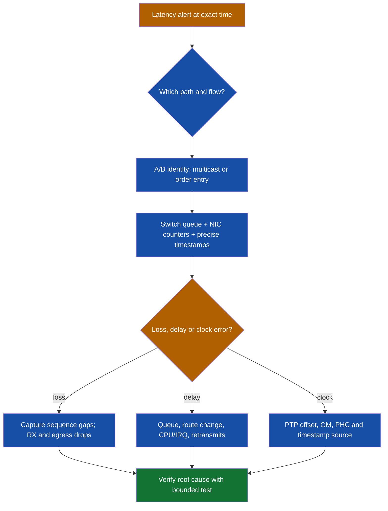

# Packet flows and troubleshooting workflows

## Contents

- [Normal unicast forwarding](#normal-unicast-forwarding)
- [Routing protocol to packet](#routing-protocol-to-packet)
- [Multicast market-data flow](#multicast-market-data-flow)
- [BGP route missing](#bgp-route-missing)
- [Tunnel failure](#tunnel-failure)
- [Latency incident](#latency-incident)

## Normal unicast forwarding

```text
Application send()
  ↓ host routing table (destination off-subnet?)
  ↓ ARP/ND for default gateway
  ↓ NIC → switch MAC/VLAN lookup → router ingress
  ↓ ingress ACL / PBR / VRF lookup
  ↓ RIB-derived FIB longest-prefix lookup
  ↓ adjacency rewrite; optional NAT/tunnel/security policy
  ↓ egress queue / physical link
  ↓ next router or destination
```

Use this flow to locate the first layer where observed state diverges from intended state. Capture on both sides of a suspected boundary when possible.

## Routing protocol to packet


At each arrow ask: what output proves the transition? A neighbour can be established while a route is filtered; a route can exist while the adjacency is unresolved; the adjacency can be correct while the queue drops packets.

## Multicast market-data flow

```text
Exchange source S
  → first-hop router (PIM source-side state)
  → routed PIM tree (RPF route must point toward S)
  → last-hop router (IGMPv3 receiver requests S,G)
  → access switch snooping table
  → receiver NIC queue → application sequence counter
```

**Fault pattern:** no traffic at receiver? Verify join, `(S,G)`/`(*,G)` route state, RPF interface, switch group table and queue drops. **Traffic present but sequence gaps?** Examine source A/B feed, microburst counters, NIC ring drops and capture loss. Do not infer the cause from a single packet capture point.

## BGP route missing

```text
TCP established?
 ├─ no → reachability, ASN, source/update-source, TTL, authentication
 └─ yes → prefix advertised by peer?
          ├─ no → peer source RIB/network/redistribution/export policy
          └─ yes → inbound policy accepted? next hop reachable?
                   ├─ no → fix policy or next-hop reachability
                   └─ yes → best path selected? RIB installed?
                            ├─ no → compare attributes, AD and competing route
                            └─ yes → inspect CEF, adjacency, ACL and return path
```

## Tunnel failure

```text
Underlay reachability → tunnel endpoints → GRE/mGRE → NHRP registration
→ overlay route → IPsec SA → forwarding → PMTU/MSS → application
```

Small ping passing while bulk transfer fails often points to MTU/MSS or fragmentation/ICMP handling, though loss and policy remain possible. Probe packet sizes and capture where drops begin.

## Latency incident



Record both the symptom window and a healthy comparison window. A clock offset can make one-way latency appear to change without a packet path change. Conversely, synchronised clocks do not rule out queueing.
